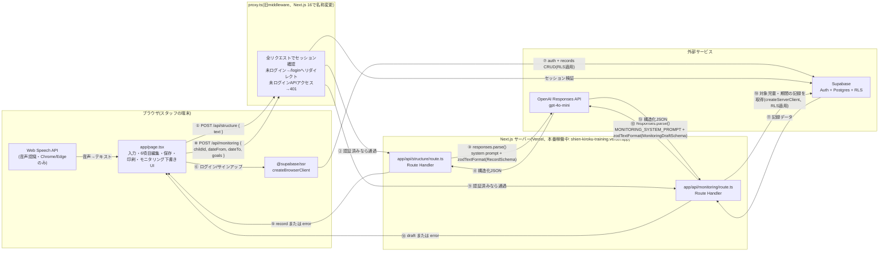

# システム構成図

生成日: 2026-09-10(初版)、2026-09-10 Supabase導入で全面改訂、2026-09-17 モニタリングAPI追加・本番稼働状態に更新
対象: AI記録支援(本番PoC) — `poc-app/`

## 全体構成

## コンポーネント

| コンポーネント | 役割 | 実行場所 |
|---|---|---|
| `app/record.ts` | `RecordSchema`(zod)・`CATEGORY_META`・保存レコード形式(`SavedRecordSchema`)の唯一の定義。個別支援計画モニタリング下書き(`/api/monitoring`)の`MonitoringGoalInputSchema`・`MonitoringDraftSchema`・`MonitoringApiResponseSchema`もここに集約する。 | 共有(サーバー/クライアント両方からimport) |
| `app/page.tsx` | 入力(テキスト・音声)、AI呼び出しの起動、6項目の表示・直接編集・コピー・保存・印刷、施設作成・招待UI、機械チェック(`findIncidentMismatches`)、児童・記録日による保存済み記録の絞り込み、個別支援計画モニタリング下書き生成UI(セクション4)。セクション2(日々の記録)とセクション4のどちらを印刷するかを`printTarget` stateで切り替える。`force-dynamic`指定(セッション依存でユーザー間共有できる静的コンテンツを持たないため)。 | クライアント(ブラウザ) |
| `app/login/page.tsx` | メール+パスワードでのログイン・新規登録フォーム。 | クライアント(ブラウザ) |
| `app/supabase-browser.ts` | ブラウザ用Supabaseクライアント(`createBrowserClient`)。anon keyのみ使用。 | クライアント(ブラウザ) |
| `app/supabase-server.ts` | サーバー用Supabaseクライアント(`createServerClient`)。`app/api/monitoring/route.ts`がブラウザのセッションCookieを転送してSupabaseへ問い合わせる際に使う(`service_role`は使わない。RLSはユーザーのセッションのまま適用される)。 | サーバー |
| `app/facility.ts` | 所属施設の取得・作成・スタッフ招待(`invite_to_facility` RPC呼び出し)。 | クライアント(ブラウザ) |
| `app/records.ts` | 施設の記録一覧取得・保存・削除。DBから読んだ`record`(jsonb)は`RecordSchema`で検証し、壊れた行は読み捨てる。`child_id`(対象児童)・`record_date`(記録対象日)もここで読み書きする。`loadRecordsForChild`は対象児童・期間を指定して記録を取得する関数で、ブラウザ側(`app/page.tsx`)と`app/api/monitoring/route.ts`(サーバー側、`supabase-server.ts`経由)の両方から呼ばれる。 | クライアント(ブラウザ)・サーバー(`/api/monitoring`から) |
| `app/children.ts` | 施設の児童マスタ(仮名・ニックネームのみ)の一覧取得・登録。学年は保存せず、`gradeLabel()`が入学年度(`enrollment_year`)から都度算出する(生年月日は持たない)。 | クライアント(ブラウザ) |
| `app/database.types.ts` | `supabase/schema.sql`と対応する手書きのTypeScript型。プロジェクト作成後は`supabase gen types`で生成し直すこと。 | 共有 |
| `app/api/structure/route.ts` | リクエストをzodで検証し、OpenAI Responses APIを呼び出し、応答を`RecordSchema`で検証して返す。同じファイル内に、直近記録との継続コメントだけを生成する専用の小さい呼び出し(`ContinuityNoteSchema`・`buildContinuityNote()`、CHANGE-012)も持つ。`OPENAI_API_KEY`はここでのみ使用。 | サーバー |
| `app/api/monitoring/route.ts` | 対象児童・対象期間・支援目標入力を受け取り、`loadRecordsForChild`(`supabase-server.ts`経由、RLS適用)でその期間の蓄積記録を取得し、`responses.parse()`(`MonitoringDraftSchema`)で個別支援計画モニタリングの下書きを生成する。生成結果はDBに保存しない(呼び出しのたびに作る)。`OPENAI_API_KEY`はここでも使用。 | サーバー |
| `proxy.ts` | 全リクエストでSupabaseセッションを検証・更新。未ログインなら`/login`へリダイレクト、未ログインでの`/api/*`アクセスは401を返す。 | サーバー(Edge/Nodeランタイム、リクエストの前段) |
| `supabase/schema.sql` / `rollback.sql` | `facilities` / `facility_members` / `records` / `children`テーブル、RLSポリシー、招待用RPC(`invite_to_facility`)を定義する冪等なDDL。db-changeスキルの方針に従う。 | Supabase(Postgres) |

## データフローと信頼境界

| 境界 | 検証方法 | 理由 |
|---|---|---|
| ブラウザ → `/api/structure`(①②) | `proxy.ts`が未ログインを401で拒否 → `RequestSchema.safeParse`(`route.ts`) | 未ログインでのAI呼び出し(=OpenAI従量課金の踏み台)を防ぐ。クライアント入力自体も信用しない。 |
| サーバー → OpenAI(③) | — (送信のみ) | **未解決**: 児童の健康情報等を含みうる自由文をOpenAI社に送信する。個人情報保護要件は`../research/itabashi-2026-08/poc/poc-spec.html` §7で未検証と明記済み。PoC期間中はダミーデータのみを使う運用でカバーしている。 |
| OpenAI → サーバー(④) | `zodTextFormat(RecordSchema, ...)` + `response.output_parsed` | 外部APIの応答は形式が保証されていない前提で扱う。 |
| サーバー → ブラウザ(⑤) | `ApiResponseSchema.safeParse`(`page.tsx`) | 自前のAPIでもネットワークを跨ぐ以上、実際に検証してから使う。 |
| ブラウザ ⇄ Supabase(⑥⑦) | **RLS**(`supabase/schema.sql`)。`records`/`facility_members`/`facilities`/`children`はすべて`is_facility_member()`ベースのポリシーで、自分が所属する施設の行しか読み書きできない。読み出し後も`SavedRecordSchema`/`RecordSchema`で再検証。 | Supabaseではクライアントが直接DBを叩く構成のため、**RLSが唯一のアクセス制御**(db-changeスキル原則7)。加えてDBの内容も「壊れていない」保証はない(手動編集・アプリ更新途中など)ため、読み出し時にzodで再検証する。 |
| ブラウザ → `/api/monitoring`(⑧⑨) | `proxy.ts`が未ログインを401で拒否 → `RequestSchema.safeParse`(`route.ts`) | 未ログインでのAI呼び出しを防ぐ。`childId`・期間・支援目標も信用せずサーバー側で検証する。 |
| サーバー → Supabase(⑩⑪) | **RLS**。`createServerClient`(`app/supabase-server.ts`)がブラウザのセッションCookieを転送してクエリするため、`service_role`は使わず、ブラウザから直接叩く場合と同じRLSポリシーがそのまま適用される。 | `/api/monitoring`はこの1経路だけ例外的にVercelを経由してSupabaseへアクセスする(モニタリング生成に必要な期間分の記録をサーバー側で組み立てるため)。それでもアクセス制御の主体はRLSであり、Vercel側に独自の認可ロジックは書いていない。 |
| サーバー → OpenAI(⑫) | — (送信のみ) | 児童の記録本文(複数件の時系列)をOpenAI社に送信する。リスクの性質は「サーバー → OpenAI(③)」の行と同じ(未解決)。 |
| OpenAI → サーバー(⑬) | `zodTextFormat(MonitoringDraftSchema, ...)` + `response.output_parsed` | 外部APIの応答は形式が保証されていない前提で扱う。支援目標数と`goalEvaluations`件数が一致しない場合は1回だけ取り直す。 |
| サーバー → ブラウザ(⑭) | `MonitoringApiResponseSchema.safeParse`(`page.tsx`) | 自前のAPIでもネットワークを跨ぐ以上、実際に検証してから使う。 |

## 認証・アクセス範囲の設計

- **ログイン方式**: メール+パスワード(Supabase Auth)。
- **共有範囲**: 施設(`facilities`)単位。同じ施設に所属するスタッフ全員が、施設内の記録をすべて閲覧・編集・削除できる(個人ごとの記録の分離はしない)。実際の現場運用(誰が記録してもチーム全員が見られる必要がある)に合わせた設計。
- **施設への参加**: 施設作成者が`owner`として自動的にメンバーになる(DBトリガー`handle_new_facility`)。他のスタッフは、既存メンバーが**サインアップ済みのメールアドレスを指定して**`invite_to_facility` RPCで招待する。未サインアップのメールアドレスへの招待はできない(この段階では招待メール送信機能は実装していない)。
- **ロール**: `facility_members.role`に`owner`/`staff`を持つが、現時点ではUI・RLSともにロールによる権限差は設けていない(全メンバーが対等)。将来、削除権限などをownerに限定する場合はここを拡張する。

## 機密情報の扱い

- `OPENAI_API_KEY`はサーバー側(`route.ts`)でのみ`process.env`から読み、クライアントに一切渡らない。
- `NEXT_PUBLIC_SUPABASE_URL` / `NEXT_PUBLIC_SUPABASE_ANON_KEY`はクライアントに公開される前提の値(接頭辞`NEXT_PUBLIC_`の通り)。実際のアクセス制御はRLSが担うため、この2つが漏れても即座にデータ漏洩にはならない。
- `service_role`キーはこのアプリでは一切使用しない(将来、管理者用の一括操作等でサーバー側に導入する場合は、クライアントに絶対渡さないこと)。

## 未解決のリスク(構成上の注意点)

1. **OpenAI社・Supabase社へのデータ送信**: ③/⑫の矢印(OpenAI)と⑦/⑩⑪の矢印(Supabase)の双方に児童の健康情報等が含まれうる。本番導入前に両社の個人情報保護・データ保持要件の確認が必要(先方向けの別紙を別途作成予定)。
2. **LLM分類の非決定性**: 同じ入力でも実行のたびに分類結果が変わりうる(`issue-log.md` ISSUE-001参照)。`incident`(特記事項)のみ機械チェックの安全網があるが、他5項目には無い。
3. **招待フローが手動**: メール送信を伴わないため、招待された側が「自分が招待されたこと」に気づく手段が無い(施設作成者が別途口頭・チャット等で伝える前提)。
4. **`proxy.ts`の認証チェックはSupabase Auth serverへの問い合わせを伴う**: Next.js公式ガイドは「Proxyでは重い処理を避け、cookieの中身だけを見る楽観的チェックに留めるべき」としているが、本実装は`@supabase/ssr`の推奨パターンに従い`getUser()`(サーバー問い合わせ)を採用している。全リクエストでレイテンシが発生する点はトレードオフとして認識しておく。
